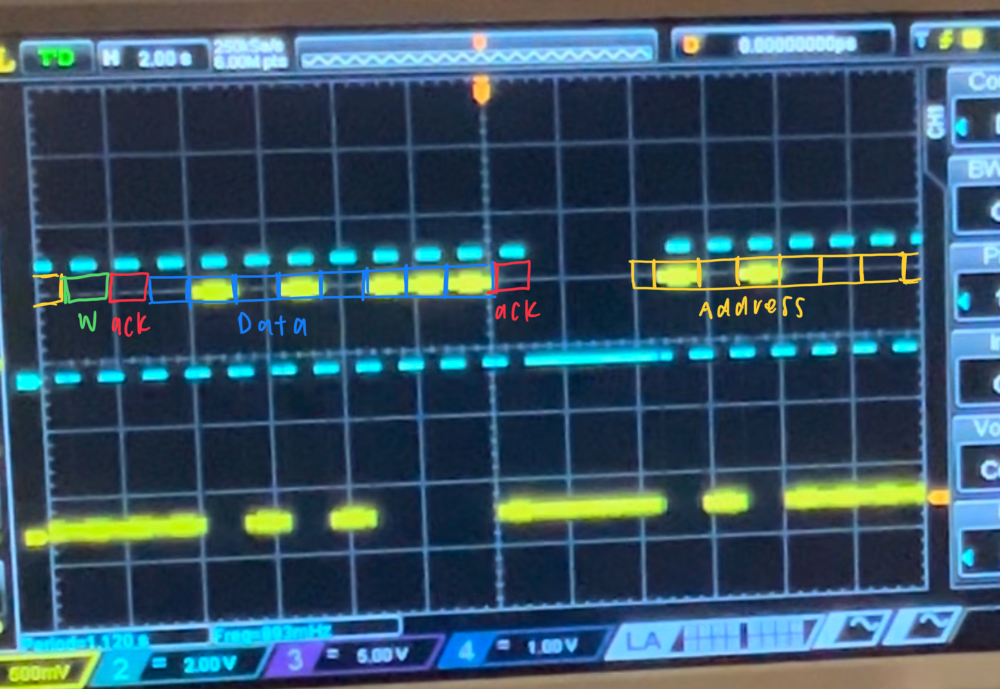

# embd-i2c-lab

## I2C Write Transaction Implementation

### Pin Configuration

For I2C communication, 2 pins are needed: one for data and one for a shared clock. Both pins were configured as GPIO-Outputs, in Output Open-Drain mode with pull up resistors. The open-drain allow multiple devices to control the I2C bus.

### Code Architecture

#### Clock Control

To have control over the clock and when data should be sent out, I created a clock signal using a timer interrupt. Each interrupt is $\frac{1}{4}$ of the time of a clock cycle. This was an important design choice because it allowed me to access the middle of each low clock signal.

In the interrupt, I track where in the clock cycle I am. So every two interrupts, I toggle the GPIO output for my clock signal.

#### State Machine

I used a state machine to manage each phase of I2C transmission:

```
I2C_IDLE
I2C_SEND_ADDRESS
I2C_WAIT_ADDRESS_ACK,
I2C_SEND_DATA,
I2C_WAIT_DATA_ACK,
I2C_STOP
```

The machine is in idle state until the main loop detects the data line go low. Then, the other states are managed by the interrupt as it's just sending out bits in a sequence. However, once it's in Stop State, the main loop then restores the data and clock lines. Although the events for the stop condition could be in the interrupt, for consistency sake, I decided to also put the stop events in the main loop like the start condition. Also, for the acknowledgements, I simulated these signals in the main loop which allows the the state machine to still function without adjustments if integrated with an actually receiver device.

## Protocol Verification With An Oscilloscope

### Wave Form & Video



The signal starts on the right half of the photo then wraps across the left half. The clock signal is in cyan.

Watch the wave form in real time [here](https://youtu.be/b1VTEBh9Euc)!

## Challenges

I really struggled with the visualization of my signals using the oscilloscope. As someone who has limited experience using the oscilloscope, I spent a great deal of time learning how to set up to oscilloscope and adjust the views and settings to optimally see the small signals coming through. When I first tried to visualize my clock signal, I was getting nothing. I simplified my code to base cases to test whether the problem was oscilloscope user error, firmware, or wiring. After ruling all of the options above, I decided to try a different GPIO port because I was also flashing the LED with the clock signal and knew there was an output. After switching GPIO ports, my signal came through. The problem ended up being that the default board configuration uses PA3 for STlink and was disrupting what I was trying to put out on that pin.
